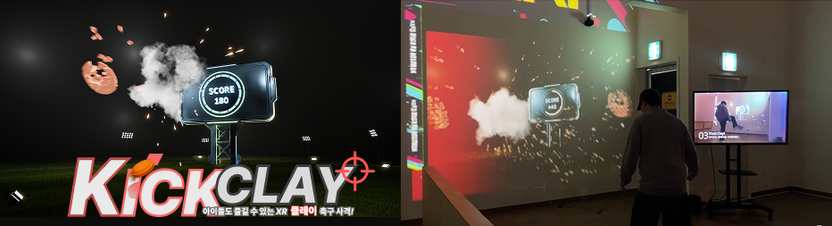
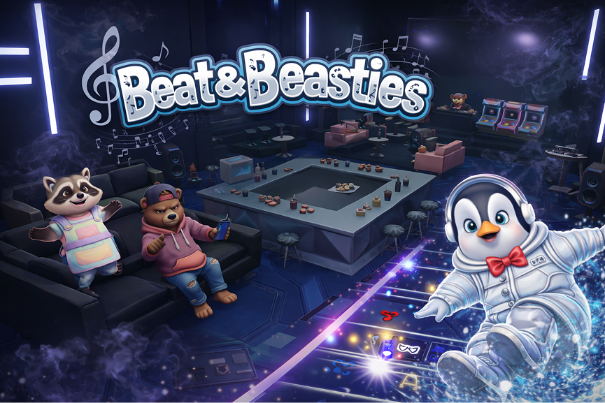
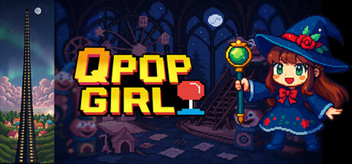

# 🎮 Unreal C++ Gameplay Programmer | Interaction & Physics-Based Gameplay

Unreal Engine 5와 C++를 중심으로 **게임플레이 시스템, 월드 상호작용, 물리 기반 파괴**를 구현하는 클라이언트 프로그래머입니다.  
DirectX 11·Unreal 렌더링 연구 경험을 바탕으로 엔진 구조와 성능을 이해하고,  
Houdini·VFX 제작 경험을 활용해 **게임 로직과 시각적 반응을 연결하는 인터랙션**에 관심을 두고 있습니다.
> **Target Position** — Unreal C++ Gameplay / Client Programmer  
> **Specialization** — Gameplay Interaction · Physics-Based Gameplay · Destruction · Optimization  

## 🛠 Tech Stack

**Programming & Engine**  
    

- **Gameplay / Client:** Gameplay Framework, Actor·Component, Input, Collision, Interactive Objects
- **학습·구현 중:** Delegate / Event-Driven Design, DataAsset, 객체 수명·GC, STL·자료구조·알고리즘, 디버깅
- **Graphics / Performance:** DirectX 11, HLSL, Unreal RDG 구조 분석, CPU/GPU Profiling
- **Supporting Skills:** Houdini, Niagara, Chaos, Python — 파괴 에셋·이펙트·제작 파이프라인 경험
- 🔗 [Technical Blog](https://piusai.github.io/) : Unreal C++, DirectX, Graphics, Houdini 및 게임 개발 과정에서 학습한 기술과 직접 구현한 기능 기록

## 🚩 Main Game & Programming Portfolio

### 01. Crazy Smash Lab — Unreal C++ Gameplay & Destruction
**상태: 기획·개발 예정 / 목표: 2027년 3월 Steam 출시**  
`Unreal Engine 5` `C++` `Gameplay Interaction` `Chaos` `Houdini` `Niagara`

Varco3D 생성 에셋과 Houdini 파괴 데이터를 활용하는 쿼터뷰 기반 파괴 게임 프로젝트입니다.

- **핵심 개발 목표:** 플레이어 입력 → 상호작용·충돌 판정 → 피해·파괴 처리 → 점수·UI 갱신으로 이어지는 C++ 게임플레이 흐름 구현
- **시스템 설계 목표:** ActorComponent, Interface, Delegate, DataAsset를 활용한 재사용 가능한 상호작용·오브젝트 데이터 구조
- **물리 상호작용:** Grab / Throw / Impulse, Chaos Geometry Collection 및 Rigid Body 연동
- **성능 검증:** Game Thread, Actor 생성·제거 및 파괴 시스템의 성능 측정과 개선
- **포트폴리오 산출 목표:** 플레이 가능 빌드, 핵심 코드·클래스 구조, 디버깅 사례, 성능 Before / After

### 02. XR KickClay — Unreal Engine Interactive XR
[▶ 시연 영상](https://www.youtube.com/watch?v=fMi-oCwVEYk) · [📄 최적화 관련 논문](https://github.com/piusAI/piusAI/blob/main/Performance%20Optimization%20of%20a%20Hybrid%20XR%20Environment%20Based%20on%20Unreal%20Engine%205.pdf)  
**2025.06 ~ 2025.10** · `Unreal Engine 5` `XR` `Realtime Input` `Optimization`

- 실시간 센서 입력과 게임 내 상호작용을 연결하는 XR 콘텐츠 개발 경험
- 대형 하이브리드 프로젝션 환경에서 입력·게임 진행·화면 출력 연동
- 엔진 성능 최적화 연구에 참여하고 결과를 학술 논문으로 정리
- **2025년 한국게임학회 추계 학술대회 논문 우수상** (원본 포트폴리오 기재 기준)

### 03. DirectX 11 — ThorPrj
[💾 소스 코드 및 기술 데모](https://github.com/piusAI/DirectX11_ThorPrj)  
**2026.06** · `C++` `DirectX 11` `HLSL`

- C++ 기반 DirectX 11 렌더링 프레임워크 구현 및 그래픽스 파이프라인 학습
- Vertex / Pixel Shader, GPU 리소스 바인딩 및 렌더링 흐름 이해
- 클라이언트 개발 시 엔진 하위 렌더링 구조를 이해하기 위한 기술 기반

### 04. Beat & Beasties — Steam Demo
[🎮 Steam 데모](https://store.steampowered.com/app/4267610/Beat__Beasties/)  
**2025.09 ~ 2026.03** · `Unity` `C#` `Houdini`

- **참여 역할:** 메인 아트 총괄 및 플레이어블 핵심 개발 참여
- 레벨 디자이너를 위한 Houdini HDA 파이프라인 구축으로 반복 제작·테스트 효율 개선
- 실제 게임 프로젝트의 개발·협업·데모 배포 경험

### 05. Q-Pop Girl — Steam Release
[🎮 Steam 정식 출시](https://store.steampowered.com/app/4157070/QPopGirl/)  
**2025.12 ~ 2026.05** · `Unity` `C#`

- **참여 역할:** Steam 론칭 빌드 및 퍼블리싱 과정 주도, 아트·콘텐츠 폴리싱 참여
- 게임 콘텐츠를 실제로 완성하고 배포 경험

## 🔬 Technical R&D — Engine, Interaction & Optimization

### Screen-Space Refraction — Unreal C++ / RDG / HLSL
**2026년 11월 연구 마무리 단계**

- 깊이 불연속을 고려한 Newton 기반 Screen-Space Refraction 보정 연구
- Unreal C++ 플러그인, RDG Pass 및 `.usf` 셰이더 구조 분석·실험
- 기존 방식과 비교한 시각적 오류 및 성능 평가
- **구현 코드에서 직접 검증·수정한 부분과 AI 보조로 작성한 부분을 구분하여 정리**

### [MotionSemantic — NC VarcoAI 관련 R&D](https://www.youtube.com/watch?v=jmdcgkskIqw&feature=youtu.be)

- FBX 애니메이션 기반 Motion Semantic Labeling 및 검색 파이프라인 연구
- 3D Geometry와 Animation IK, Motion Warping 연동 구조 검토
- C++ 인터페이스와 애니메이션 데이터 전달 구조 설계·분석

### [AIZ Tessellation Optimization](https://youtu.be/5quB66ROCn0)(진행중)

- 적응적 지형 세분화, C++ / HLSL / Compute Shader / RDG 연구 진행
- 현재 GT->RT로 보내는 과정에서 프레임 드랍이 너무 심해서 아이디어 오류인 것 같아 잠시 보류

## 📂 Additional Projects & Art Background

| 프로젝트 / 작업 | 내용 |
| --- | --- |
| [Unity-HDA](https://youtu.be/5EGHmrIraA0) | Houdini HDA 기반 Unity 맵 생성 프로토타입 |
| [Houdini Procedural Modeling](https://www.youtube.com/playlist?list=PLcBkRBTJf8ZI9YiDyFrWVfVmLf8Bs3cWU) | VEX / HDA를 활용한 절차적 모델링 및 파이프라인 |
| [RAG + Qdrant + Streamlit](https://youtube.com/shorts/fpU0kqvtkbo) | RAG 기반 프로토타입 |
| [실시간 자세 추정 및 점수 시각화](https://youtu.be/2spXeHQ4doA) | 실시간 분석·점수 시각화 프로토타입 |
| [VFX Art Portfolio](https://www.artstation.com/piusai) | Unreal / Houdini 기반 FX, VAT / SDF / Destruction 제작 경험 |

## 🎓 Education & Awards

- **홍익대학교 게임 관련 석사 과정:** 2025.09 ~ 2027.08 (졸업 예정)
- **2025 한국게임학회 추계 학술대회 논문 우수상:** [언리얼 엔진5 기반 하이브리드 프로젝션 XR 환경 성능 최적화](https://github.com/piusAI/piusAI/blob/main/Performance%20Optimization%20of%20a%20Hybrid%20XR%20Environment%20Based%20on%20Unreal%20Engine%205.pdf)

## 📬 Contact

- **GitHub:** https://github.com/piusAI
- **Blog:** https://piusai.github.io/
- **ArtStation:** https://www.artstation.com/piusai
- **YouTube:** https://www.youtube.com/@h0wju
- **Email:** hwangpiusjoon@gmail.com

