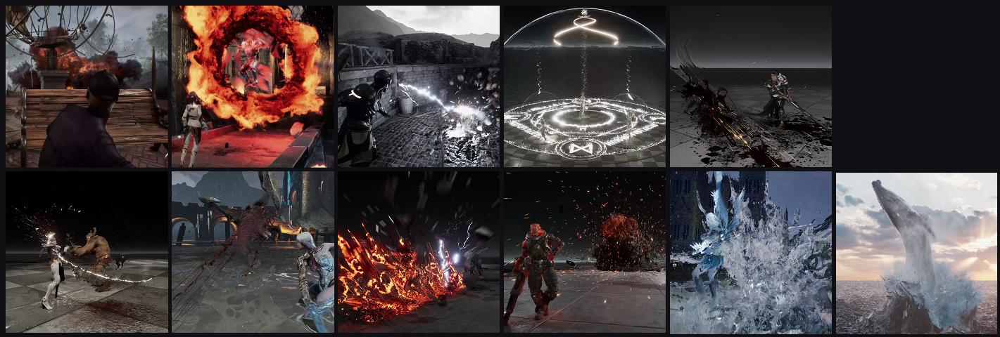

# 🎮 Unreal C++ Gameplay Programmer | Interaction & Physics-Based Gameplay

Unreal Engine 5와 C++를 중심으로 **게임플레이 시스템, 월드 상호작용, 물리 기반 파괴**를 구현하는 클라이언트 프로그래머입니다.
DirectX 11·Unreal 렌더링 연구 경험을 바탕으로 엔진 구조와 성능을 이해하고, Houdini·VFX 제작 경험을 활용해 **게임 로직과 시각적 반응을 연결하는 인터랙션**에 관심을 두고 있습니다.

## 🛠 Tech Stack
### Core
     

- **Gameplay / Client:** Gameplay Framework, Actor·Component, Input, Collision, Interactive Objects
- **학습·구현 중:** Delegate / Event-Driven Design, DataAsset, 객체 수명·GC, STL·자료구조·알고리즘, 디버깅
- **Graphics / Performance:** DirectX 11, HLSL, Unreal RDG 구조 분석, CPU/GPU Profiling
- **Supporting Skills:** Houdini, Niagara, Cascade, Chaos, Python — 파괴 에셋·이펙트·제작 파이프라인 경험

### 🚩 Main Project Portfolio

| MainProject                                                                                                                                                                                                                                                                                                                                                                                                                                                                                                                                                                                                                                                                                                                                                                                                                                                                               |
| :---------------------------------------------------------------------------------------------------------------------------------------------------------------------------------------------------------------------------------------------------------------------------------------------------------------------------------------------------------------------------------------------------------------------------------------------------------------------------------------------------------------------------------------------------------------------------------------------------------------------------------------------------------------------------------------------------------------------------------------------------------------------------------------------------------------------------------------------------------------------------------------- |

|    **🎮 [Beat & Beasties (Steam 데모 출시)](https://store.steampowered.com/app/4267610/Beat__Beasties/)**  <small style="color: #666;">📅 2025.09 ~ 2026.03</small>     · **메인 아트 총괄 및 플레이어블 핵심 개발 참여**   · 레벨 디자이너용 HDA 파이프라인 구축을 통해 **프로젝트 반복 테스트 비용 대폭 절감**                                                             |
|    **💾[DirectX 11 기술 데모 ](https://github.com/piusAI/DirectX11_ThorPrj)**  <small style="color: #666;">📅 2026.06</small>        · 렌더링 파이프라인의 본질적 이해를 위해 밑바닥부터 직접 구현한 로우레벨 그래픽스 프레임워크  · 커스텀 그래픽스 파이프라인 설계 및 자체 HLSL 셰이더 빌드                                                                                                |
| **🎮 [Q-Pop Girl (Steam 정식 출시)](https://store.steampowered.com/app/4157070/QPopGirl/)**   <small style="color: #666;">📅 2025.12 ~ 2026.05</small>    · **글로벌 스팀 플랫폼 론칭 빌드 및 퍼블리싱 과정 주도**  · 아트 참여 및, 콘텐츠 폴리싱                                                                                                                                                                                                                               |
|   **🎨 [VFX Portfolio](https://www.artstation.com/piusai)**  <small style="color: #666;">📅 2024.04 ~ 2025.03</small>     · AAA 게임 타겟 실시간 이펙트 퀄리티 구현  · VAT, Animation keyframe 동적 생성 Mesh 등 절차적 VFX 파이프라인 구축                                                                                                                                                                                                 |
|   **🎮 [XR KickClay](https://www.youtube.com/watch?v=fMi-oCwVEYk)**   <small style="color: #666;">📅 2025.06 ~ 2025.10</small>      · [언리얼 엔진5 기반 하이브리드 프로젝션 XR 환경 성능 최적화](https://github.com/piusAI/piusAI/blob/main/Performance%20Optimization%20of%20a%20Hybrid%20XR%20Environment%20Based%20on%20Unreal%20Engine%205.pdf)  · 🏆 2025년 한국 게임 학회 추계 학술대회 논문 우수상 수상작  · 대형 하이브리드 프로젝션 XR 환경에서의 실시간 센서 연동 시스템 구축 |

### 🛠️ Other Technical R&D & Prototypes (기타 연구 및 프로토타입)

| 프로젝트 제목                                                                                                    | 핵심 기술                                               |     개발 기간     |
| :--------------------------------------------------------------------------------------------------------- | :-------------------------------------------------- | :-----------: |
| [📺 Unity-HDA](https://youtu.be/5EGHmrIraA0)                                                               | 우주 배경의 맵 생성을 위해 Houdini HDA 구조를 활용한 Unity HDA 프로토타입 |     25.06     |
| [📺 Houdini Procedural Modeling](https://www.youtube.com/playlist?list=PLcBkRBTJf8ZI9YiDyFrWVfVmLf8Bs3cWU) | Houdini VEX 기반 절차적 모델링 및 HDA 파이프라인 구축               | 23.10 ~ 24.04 |
| [📺 RAG + QDrant + Streamlit](https://youtube.com/shorts/fpU0kqvtkbo)                                      | RAG 기반 축구인 재활 프로토타입                                 | 25.11 ~ 25.12 |
| [📺 실시간 자세 추정 및 점수 시각화](https://youtu.be/2spXeHQ4doA)                                                      | 실시간 자세 추정/분석 프로토타입                                  | 25.07 ~ 25.10 |

## 🚀 Technical R&D (기술 연구 및 진행 중인 프로젝트)
  
### 🏔️ [C++ RDG & Compute Shader 기반 Tessellation Optimize 진행 중](https://youtu.be/5quB66ROCn0) (논문 투고예정)
- UE5 C++ Render Dependency Graph(RDG) 패스 및 `.usf` Compute Shader 구축
- GPU 기반 VRAM 대역폭 절감 및 실시간 Dynamic Mesh Deformation Optimize
- Render Thread / RHI 병목 분석 및 RenderDoc, Unreal Insights 기반 프로파일링

### ⚙️ [MotionSemantic (NC VarcoAI 과제)](https://www.youtube.com/watch?v=jmdcgkskIqw&feature=youtu.be)
- FBX 애니메이션 데이터를 기반으로 한 **Motion Semantic Labeling Pipeline** 자동화 R&D
- Animation Clip 의미 검색 및 Motion DataBase 구축
- 3D Geometry 분석 기반 Traversal 포인트 수신 후 **Animation IK 전달 및 조작 파이프라인 연동**
- Motion Warping 및 IK Sync Point C++ 인터페이스 데이터 수송 구조 설계

### 💻 DirectX 11 + HLSL
- 그래픽스 파이프라인 매커니즘 이해를 위한 커스텀 C++ 렌더링 엔진 프레임워크 구축 (`ThorPrj`)
- PipeLine State Object(PSO) 제어 및 커스텀 HLSL Shader(VS/PS/CS) 구현

### 🛠️ Unreal Engine C++ Plugin & Editor Tooling
- Slate / Editor Subsystem 기반 커스텀 에디터 모듈 및 아티스트 전용 파라미터 제어 툴 R&D
- C++ Engine Tooling을 활용한 에셋 검증(Validation) 및 빌드 파이프라인 자동화

### 🪄 Houdini Engine & HDA Automation
- Houdini VEX 기반 절차적 메쉬 생성 및 UE5/Unity 연동용 Houdini Digital Asset(HDA) 제작
- 레벨 디자이너 및 아티스트용 절차적 렌더링/VFX 에셋 배치 파이프라인 구축

### 🐍 Blender Python DCC Pipeline
- Blender Python API 기반 에셋 자동 검증, UV/Pivot 정렬, Export 파이프라인 애드온 개발
- DCC ↔ Unreal Engine 간 데이터 인터페이스 스크립팅 및 워크플로우 최적화

## 🎓 Education & Awards
- 2025 한국 게임학회 추계 학술대회 논문 우수상(25.10) : [언리얼 엔진5 기반 하이브리드 프로젝션 XR 환경 성능 최적화](https://github.com/piusAI/piusAI/blob/main/Performance%20Optimization%20of%20a%20Hybrid%20XR%20Environment%20Based%20on%20Unreal%20Engine%205.pdf)
- **홍익대학교 게임학부 석사 과정** : 25.09 ~ 27.08

## 📧 Contact
- **Email :** hwangpiusjoon@gmail.com
- **Blog :** https://piusai.github.io/
- **ArtStation :** https://www.artstation.com/piusai
- **Youtube :** https://www.youtube.com/@h0wju

