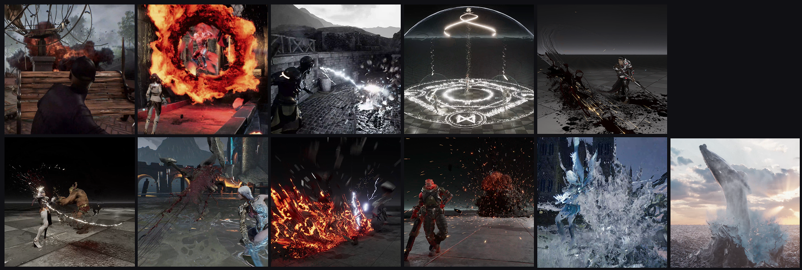
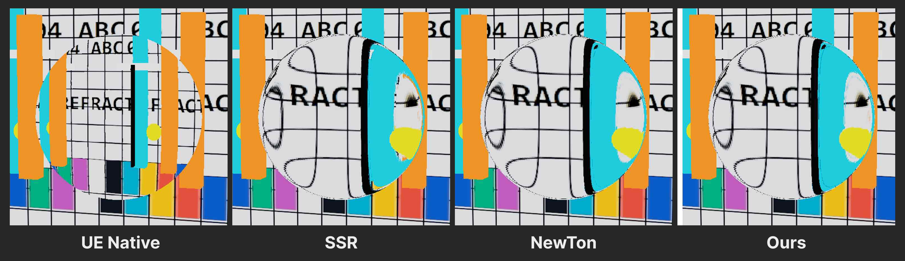
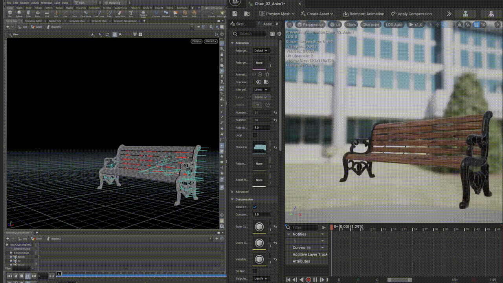
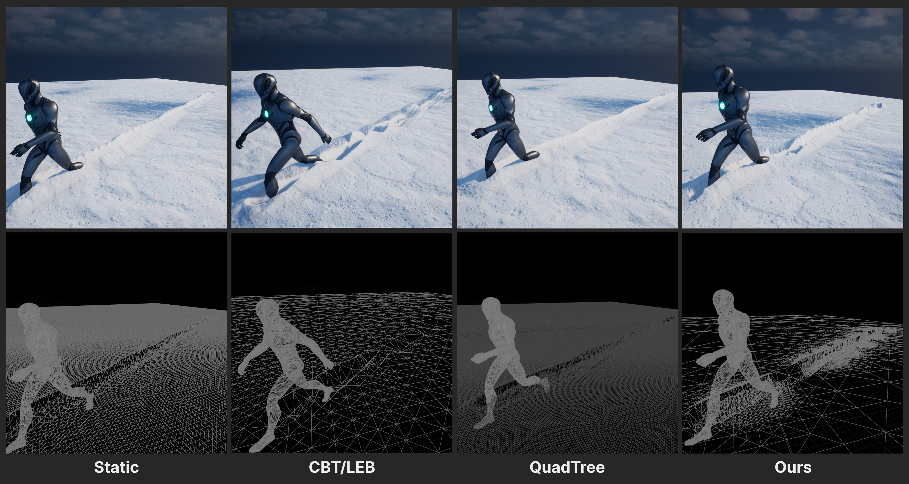
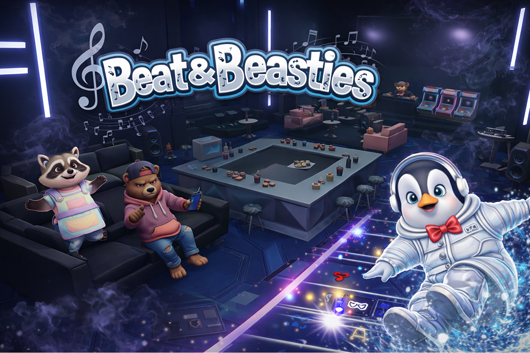
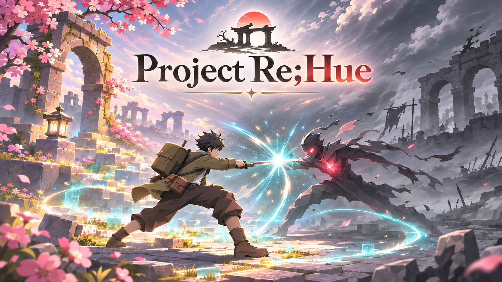
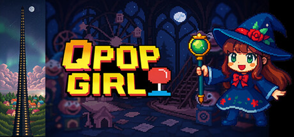
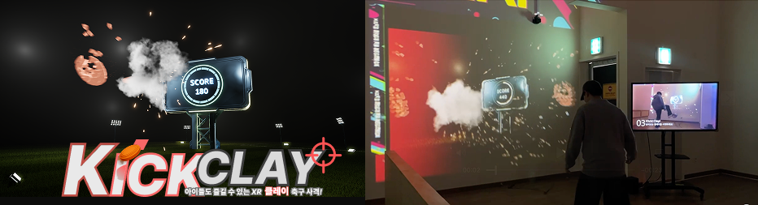
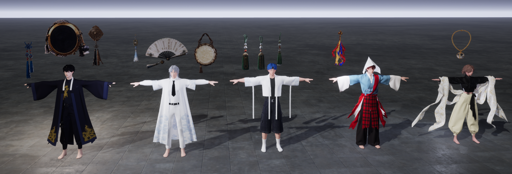

# 🎇 VFX / Rendering Technical Artist

▸ Real-Time VFX, Shader, Physics 기반 파괴 연출 및 최적화를 중심으로  
아트와 엔진 기술을 연결하는 **Technical Artist 황효준**입니다.  

▸ Houdini 기반의 절차적 제작과 Niagara/CasCade를 활용한 실시간 VFX 경험을 바탕으로  
DirectX 11· C++ · HLSL · Unreal RDG · Chaos Physics까지 기술 영역을 확장하고 있습니다. 

▸ 3D Art 제작 Pipeline 전반과 게임 엔진의 내부 구조 및 Low-Level 그래픽스 파이프라인에 대한 이해를 바탕으로  
시각적 완성도와 실시간 성능을 조율 하는데에 관심을 두고 있습니다.

**관심 분야** : Real-Time VFX · Houdini / Procedural Workflow · Shader / HLSL · Chaos Destruction · Optimization

## 🛠 Tech Stack

**Technical Art & Engine**  
    

- **Technical Art / VFX**: Houdini (VEX / HDA), Niagara, Cascade, VAT, SDF, Procedural Asset Pipeline
- **Physics / Destruction**: Chaos Physics, Geometry Collection, Fracture, Physics Fields, Physics-Driven VFX
- **Rendering / Shader**: HLSL (.usf / .ush), Unreal Material, Global Shader, RDG, Screen-Space Refraction
- **Engine / Programming**: Unreal C++ Plugin, SceneViewExtension, DirectX 11, C++, Python, STL
- **Optimization**: CPU/GPU Profiling, Shader Optimization, VFX Optimization, Performance Analysis
- 🔗 [Technical Blog](https://piusai.github.io/) — Unreal C++, DirectX, Game Engine Architecture,HLSL, Houdini 기술 학습·구현 및 분석 기록

## 🚩 Main Portfolio

### 01. VFX Tech Art
- Chaos Module · Houdini 연동
- 
### 02. Shader Tech Art
- usf

### 03. Real-Time VFX Portfolio — Unreal Engine & Houdini
[🎨 ArtStation VFX Portfolio](https://www.artstation.com/piusai)  
**2024.04 ~ 2025.03** · `Unreal Engine 5` `Houdini` `Niagara` `CasCade` `VFX` `VAT`

- UE Niagara Cascade **실시간 게임 VFX 포트폴리오 제작**
- Niagara, Material, Shader를 활용한 다양한 게임 이펙트 구현
- Houdini 절차적 Mesh 및 파괴 이펙트** 제작

- Houdini 기반 VAT Blood Fluid Simulation
  
### 04. DirectX 11 — ThorPrj
[💾 소스 코드 및 기술 데모](https://github.com/piusAI/DirectX11_ThorPrj)  
**2026.06** · `C++` `DirectX 11` `HLSL`

- C++ 기반 DirectX 11 Rendering FrameWork 구현 및 그래픽스 파이프라인 학습
- Vertex / Pixel Shader, GPU Resource Binding / Rendering 흐름 이해
- 상용 엔진의 하위 렌더링 구조를 이해하기 위한 기술 기반

## 🔬 Technical R&D — Engine, Interaction & Optimization

### 01. 굴절 RDG Pass  (KCI 투고완료)
[🎞️ 시연 영상](https://www.youtube.com/shorts/oU3UkWu6Gt0)  

- Unreal C++ / RDG / HLSL  
- 깊이 불연속을 고려한 Newton 기반 Screen-Space Refraction 보정 연구
- Unreal C++ 플러그인, RDG Pass 및 `.usf` 셰이더 구조 분석·실험
- 기존 방식과 비교한 시각적 오류 및 성능 평가
- Full Triangle RDG Pass 등록

### 02. NCAi R&D - Physics Destruction & Motion Semantics
#### A. Physics GameReady Asset Pipeline - Chaos Desturction
`VARCO 3D` `Unreal Engine` `Geometry Collection` `Chaos Destruction`  
[🎞️ 고화질 영상](https://www.youtube.com/watch?v=G29czu3R7i0)  

- VARCO 3D Asset Mesh Parts와 Parts별 물리 속성을 Unreal Geometry Collection을 활용한 자동 연동 파이프라인 연구 中
- Geometry Collection을 Chaos와 연동해 충돌 시 파츠가 분리, 물리 시뮬레이션으로 움직이는 런타임 파괴 구조 구현

#### B. Animation Motion Semantic  
[🎞️ 시연 영상](https://www.youtube.com/watch?v=jmdcgkskIqw&feature=youtu.be)  
- FBX 애니메이션 기반 Motion Semantic Labeling 및 검색 파이프라인 연구
- 3D Geometry와 Animation IK, Motion Warping 연동 구조 검토

### 03. Active Interaction Zone : Dynamic Tesselation (보류中..)
[🎞️ 시연 영상](https://youtu.be/5quB66ROCn0)

`Unreal Engine` `C++` `HLSL` `Compute Shader` `RDG`

- **Render Target 연동** — Blueprint 기반 Render Target 처리 로직을 C++로 이관하고, MPC(Material Parameter Collection)를 통해 셰이더에 파라미터가 전달되는 흐름 분석
- **적응형 지형 테셀레이션** — 상호작용 영역에 따라 지형의 세분화 수준을 조절하는 방식을 Compute Shader와 RDG 기반으로 실험
- **성능 이슈** — Game Thread → Render Thread 데이터 전달을 포함한 테스트에서 프레임 저하가 관찰되어 실험을 보류. 병목 원인은 추정중..

## 🕹️ Game & Shipping Project
### 01. Beat & Beasties — Steam Demo
[🎮 Steam 데모](https://store.steampowered.com/app/4267610/Beat__Beasties/)  
**2025.09 ~ 2026.03** · `Unity` `C#` `Houdini`

- **참여 역할:** 메인 아트 총괄 및 플레이어블 핵심 개발 참여
- 레벨 디자이너를 위한 Houdini HDA 파이프라인 구축, 반복 제작·테스트 효율 개선
- 실제 게임 프로젝트의 개발·협업·데모 배포

### 02. Project Re;Hue — Unreal Engine Action & Technical Art
[🎞️ 초기 개발 영상](https://youtu.be/py8AtDtcPaM)

**2026.11 ~ 진행 중 | 2027년 3월 Steam 출시 계획**

`Unreal Engine 5` `C++` `HLSL` `Niagara` `Houdini` `Chaos` `VARCO 3D`

**전쟁 이후 남겨진 상실의 기억을 마주하고, 잃어버린 색을 되찾는 추억으로 채워주는 쿼터뷰 액션 게임**

칼 공격과 패링으로 악령을 정화하고, 흑백으로 잠식된 공간에 색(Hue)을 되돌려 기억을 되찾는다

- Gameplay: 칼 공격, 패링, 경직 및 마무리 공격 중심의 전투 시스템 설계
- Rendering / Shader: Material / HLSL 기반 흑백 잠식 및 Hue 색채 복원 효과
- Technical VFX: Niagara 기반 검 공명, 타격 피드백 및 악령 분해 연출
- Destruction: VARCO 3D 물리 파츠 활용 및 Houdini Fracture / Chaos 기반 파괴 시스템 검토
- Animation: [VARCO 3D → Maya → Unreal Engine](https://youtu.be/6giy8WyuEvI) 애니메이션 에셋 검수 및 엔진 연동
- Optimization: Unreal Insights 및 CPU/GPU Profiling 기반 성능 검증 계획
※ 전투·셰이더·물리 파괴 시스템은 개발 예정 항목이며, 구현 범위는 프로토타입 검증 결과에 따라 조정

### 03. Q-Pop Girl — Steam Release
[🎮 Steam 정식 출시](https://store.steampowered.com/app/4157070/QPopGirl/)  
**2025.12 ~ 2026.05** · `Unity` `C#`

- **참여 역할:** Steam 론칭 빌드 및 퍼블리싱 과정 주도, 아트·콘텐츠 폴리싱 참여
- 게임 콘텐츠를 실제로 완성하고 배포

### 04. XR KickClay — Unreal Engine Interactive XR
[🎞️ 시연 영상](https://www.youtube.com/watch?v=fMi-oCwVEYk) · [📄 최적화 관련 논문](https://github.com/piusAI/piusAI/blob/main/Performance%20Optimization%20of%20a%20Hybrid%20XR%20Environment%20Based%20on%20Unreal%20Engine%205.pdf)  
**2025.06 ~ 2025.10** · `Unreal Engine 5` `XR` `Realtime Input` `Optimization`

- 실시간 센서 입력과 게임 내 상호작용을 연결하는 XR 콘텐츠 개발
- 대형 하이브리드 프로젝션 환경에서 입력·게임 진행·화면 출력 연동
- 엔진 성능 최적화 연구에 참여하고 결과를 학술 논문 발표
- **2025년 한국게임학회 추계 학술대회 논문 우수상**

### 06. Korean Traditional Music Virtual Human — Commercial Project
[🎬 캐릭터 5종 턴어라운드 : Characters & Props](https://youtu.be/zqppkoFIX0g)  
2026.05 ~ 2026.11 · `Unreal Engine 5` `Maya` `Houdini` `Varco AI Mesh` `Procedural Workflow` 

**국악 버추얼 휴먼 프로젝트 - 캐릭터 제작 총괄 및 Unreal Engine 기반 3D 캐릭터·소품 제작 납품**

- **Art Direction & Production:** 얼굴 스컬핑·의상 모델러 2명과 협업, 제작 방향 설정 및 에셋 검수·수정 총괄
- **Maya / Houdini Asset Pipeline:** Varco AI 기반 Base Mesh 및 외부 제작 에셋 통합, Mesh 구조 정리 및 최종 에셋 구성
- **Procedural Asset Automation:** Houdini 기반 Prop Scale 자동 조정 툴을 활용한 소품 크기·비율 일괄 조정 및 반복 작업 효율화
- **Unreal Engine Integration:** 캐릭터·의상·소품 에셋 통합, Material Instance 분리·설정 및 최종 Scene 구성
- **Commercial Delivery:** 캐릭터 모델링 에셋 5종 및 소품 제작·납품 완료, **제작 매출 1,000만 원 달성**

※ 얼굴 스컬핑 및 의상 모델링은 외부 아티스트와 협업, 리깅·애니메이션은 제작 범위에서 제외

## 📂 Additional Projects & Art Background

| 프로젝트 / 작업 | 내용 |
| --- | --- |
| [Unity-HDA](https://youtu.be/5EGHmrIraA0) | Houdini HDA 기반 Unity 맵 생성 프로토타입 |
| [Houdini Procedural Modeling](https://www.youtube.com/playlist?list=PLcBkRBTJf8ZI9YiDyFrWVfVmLf8Bs3cWU) | VEX / HDA를 활용한 절차적 모델링 및 파이프라인 |
| [RAG + Qdrant + Streamlit](https://youtube.com/shorts/fpU0kqvtkbo) | RAG 기반 프로토타입 |
| [실시간 자세 추정 및 점수 시각화](https://youtu.be/2spXeHQ4doA) | 실시간 분석·점수 시각화 프로토타입 |
| [VFX Art Portfolio](https://www.artstation.com/piusai) | Unreal / Houdini 기반 FX, VAT / SDF / Destruction 제작 |

## 🎓 Education & Awards

- **홍익대학교 게임 관련 석사 과정:** 2025.09 ~ 2027.08 (졸업 예정)
- **2025 한국게임학회 추계 학술대회 논문 우수상:** [언리얼 엔진5 기반 하이브리드 프로젝션 XR 환경 성능 최적화](https://github.com/piusAI/piusAI/blob/main/Performance%20Optimization%20of%20a%20Hybrid%20XR%20Environment%20Based%20on%20Unreal%20Engine%205.pdf)

## 📬 Contact

- **GitHub:** https://github.com/piusAI
- **Blog:** https://piusai.github.io/
- **ArtStation:** https://www.artstation.com/piusai
- **YouTube:** https://www.youtube.com/@h0wju
- **Email:** hwangpiusjoon@gmail.com

